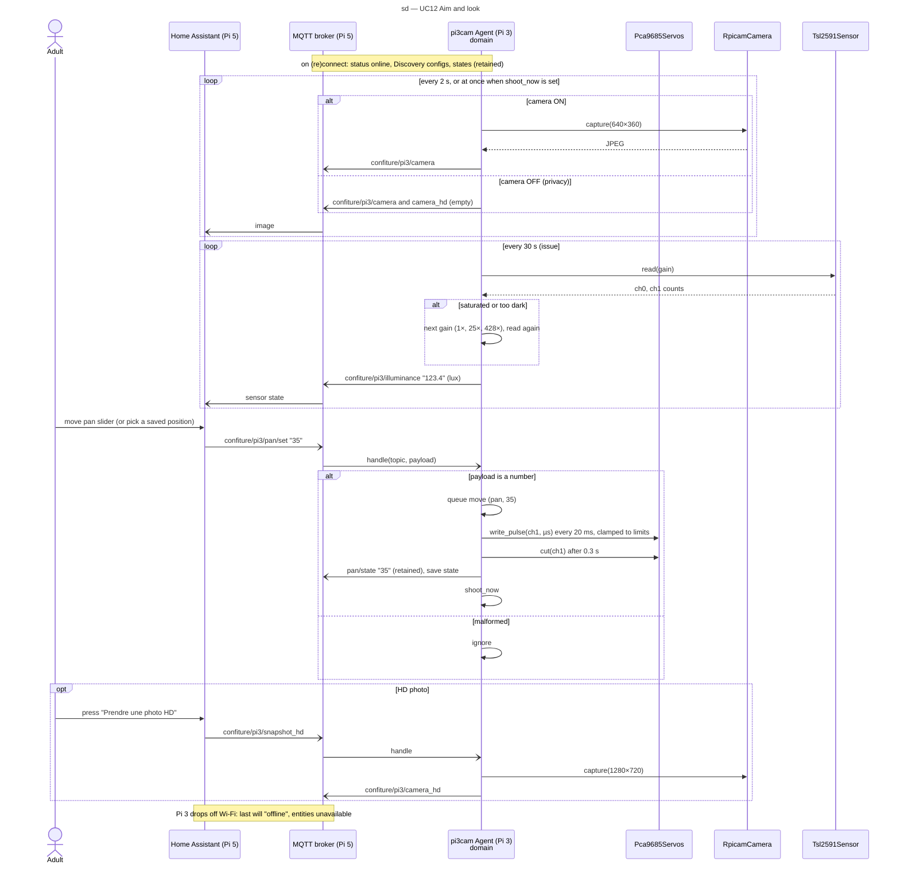

# Sequence diagram — pan-tilt-camera — UC12 Look around remotely

> **Feature**: pan-tilt-camera (issue #3)
> **Source specs**: [`voice-assistant-use-cases.md`](../../specs/voice-assistant-use-cases.md) UC12
> **Related ADRs**: ADR-0007
> **See also**: [`02-deployment.md`](02-deployment.md)

## Context

How an aim command reaches the servos and how images come back. Home Assistant never drives
the hardware: it publishes commands on MQTT; the agent clamps, ramps and cuts the servo signal
(ADR-0007). Moves are serialised in a queue so two quick commands never fight.

## Diagram

## Notes

- `-)` marks asynchronous MQTT publishes; there is no reply on the command path, the state
  topic is the acknowledgement.
- Position is commanded, not measured (no servo feedback).
- Illuminance (UC3, issue #8): the domain picks the gain and converts counts to lux; a reading
  still saturated at the lowest gain, or failed, is not published.
