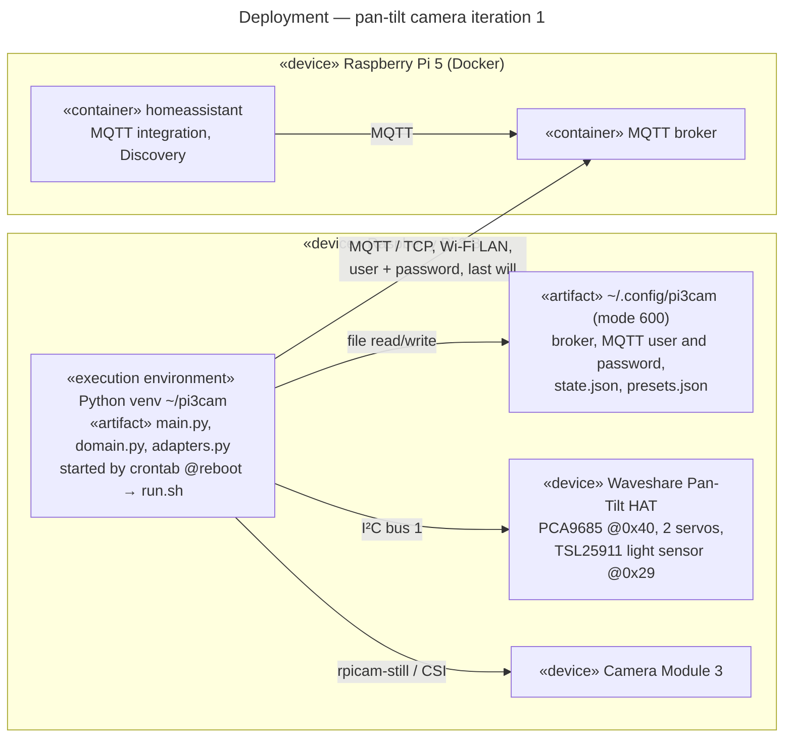

# Deployment diagram — pan-tilt-camera — iteration 1

> **Feature**: pan-tilt-camera (issue #3)
> **Source specs**: [`voice-assistant-needs.md`](../../specs/voice-assistant-needs.md) REQ-13
> **Related ADRs**: ADR-0007
> **See also**: [`01-sequence-aim-and-look.md`](01-sequence-aim-and-look.md)

## Context

Where the camera agent runs and what it talks to. The Pi 3 opens no port: it only connects out
to the broker on the Pi 5.

## Diagram

## Notes

- Secrets stay on the Pi in `~/.config/pi3cam`, never in the repository.
- Crontab instead of systemd: set up without sudo; `run.sh` restarts the agent if it exits.
