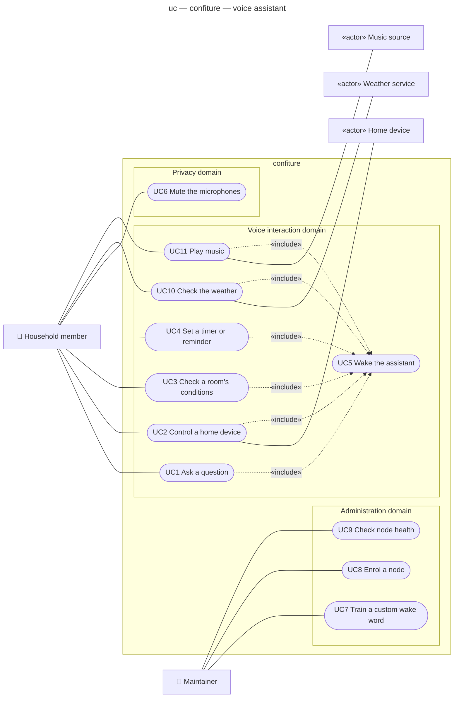

# Use case diagram — voice-assistant — who wants what

> **Feature**: voice-assistant (epic issue to be created)
> **Source specs**: [`voice-assistant-use-cases.md`](../../specs/voice-assistant-use-cases.md)
> **Related ADRs**: ADR-0001
> **See also**: `02-sequence-*.md`, `03-component.md`, `08-deployment.md` (next phase)

## Context

Phase 0 view of confiture: the goals people pursue with a fully local home voice assistant.
It does not show how the system is split (satellite / brain / sensor nodes) — that is the
component and deployment diagrams' job.

## Diagram

## Notes

- **UC5 Wake the assistant** is a subfunction (🐟): every spoken goal starts with the wake word,
  so it is shared by UC1–UC4, UC10 and UC11 through «include». It is never a goal on its own.
- The timer firing is **not** a use case (system event): it is the success guarantee of UC4.
- Room sensors (the two Pi 1 boards) are **inside** the subject: they are part of confiture, not
  actors. External systems: *Home device* (lights, plugs…), *Weather service* and *Music source*
  (streaming service or local library — to choose in phase 1).
- `Maintainer` is a role, today played by the owner; a household member may also play it.
- Internet is allowed for online services, voice stays local (ADR-0001).
