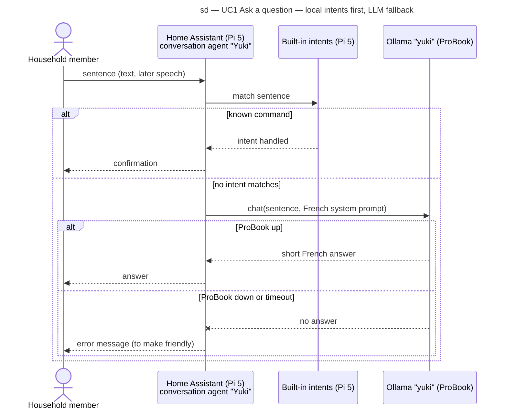

# Sequence diagram — voice-assistant — UC1 Ask a question

> **Feature**: voice-assistant (epic issue to be created)
> **Source specs**: [`voice-assistant-use-cases.md`](../../specs/voice-assistant-use-cases.md)
> **Related ADRs**: ADR-0004, ADR-0005
> **See also**: [`01-use-case.md`](01-use-case.md)

## Context

How a free question reaches the local LLM, and what happens when the LLM host is down. Known
commands never leave the Pi 5 (ADR-0004); the LLM never leaves the home (ADR-0005). Shown with
text input first: the voice pipeline (wake word, speech-to-text, text-to-speech) wraps the
same exchange later.

## Diagram

## Notes

- "Prefer handling commands locally" on the Yuki agent is what gives the first `alt`: the LLM
  only sees sentences no intent matches.
- The LLM gets no control of home devices (Ollama "control Home Assistant" off), so a wrong
  answer can never act on the house.
- The friendly "I can't think right now" message of ADR-0004 is not yet built: today the
  down-host branch returns Home Assistant's own error.
