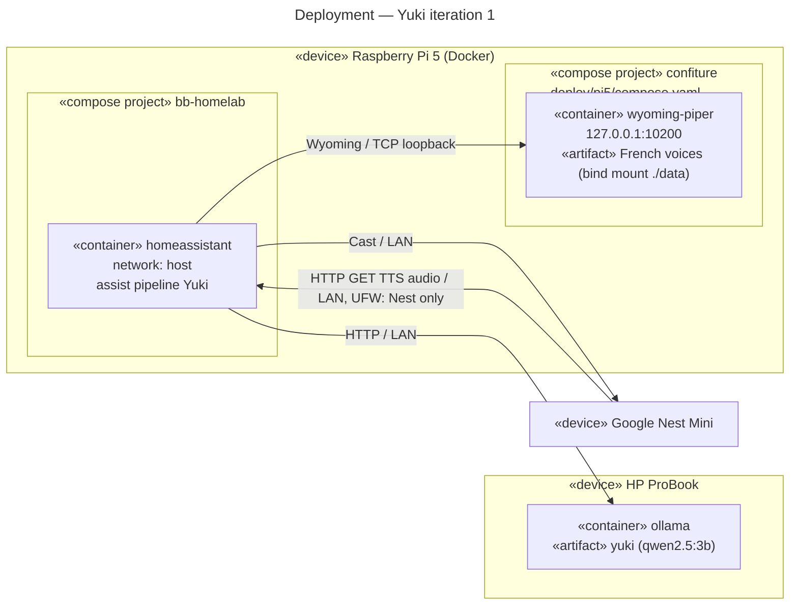

# Deployment diagram — voice-assistant — iteration 1

> **Feature**: voice-assistant (epic issue to be created)
> **Source specs**: [`voice-assistant-needs.md`](../../specs/voice-assistant-needs.md)
> **Related ADRs**: ADR-0004, ADR-0005, ADR-0006
> **See also**: [`02-sequence-ask-a-question.md`](02-sequence-ask-a-question.md)

## Context

Where each part of the Yuki voice path runs in iteration 1. The Pi 5 hosts the pipeline and
text-to-speech, the ProBook hosts the LLM (ADR-0004), and the Nest Mini plays the answers
(REQ-16). Speech-to-text and wake word are not deployed yet.

## Diagram

## Notes

- Piper is published on the loopback only: Home Assistant runs with host networking, so it
  reaches `127.0.0.1:10200`, and nothing else on the LAN can.
- The Piper container belongs to this repository (owner decision, MCDA 480 vs `docker run`
  415 vs bb-homelab 320): bb-homelab stays untouched and keeps owning Home Assistant.
- Voice models live in the `deploy/pi5/data/` bind mount (gitignored), never in the image.
- wyoming-piper lists every language it can download and fetches a voice on first use:
  `yuki_say` pins `fr_FR`, served by the installed `fr_FR-siwis-medium`.
- The Nest fetches the audio from Home Assistant's `internal_url` (the Pi LAN URL); the Pi
  firewall opens 8123 to the Nest only (ADR-0006, bb-homelab#162).
