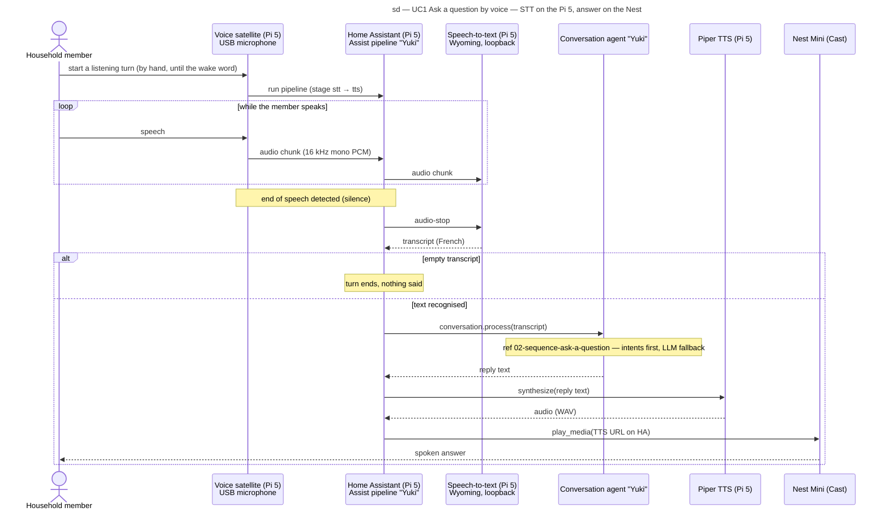

# Sequence diagram — voice-assistant — UC1 Ask a question by voice

> **Feature**: voice-assistant (benoit-bremaud/confiture#18)
> **Source specs**: [`voice-assistant-needs.md`](../../specs/voice-assistant-needs.md) (REQ-14, REQ-15, REQ-16, REQ-20)
> **Related ADRs**: ADR-0004, ADR-0005, ADR-0006, ADR-0008
> **See also**: [`02-sequence-ask-a-question.md`](02-sequence-ask-a-question.md)

## Context

Adds the listening half to UC1: a spoken question, captured by the USB microphone on the Pi 5
(REQ-15), is turned into text by a Wyoming speech-to-text container on the Pi 5 (ADR-0008), then
follows the exchange of `02-sequence-ask-a-question.md` unchanged. The wake word is a later
brick: until then a listening turn is started by hand (one turn, then the satellite waits).

## Diagram

## Notes

- Audio never leaves the Pi 5 and is never stored (REQ-20: the question log keeps text only).
- STT latency (acceptance of benoit-bremaud/confiture#18, at most 3 s) runs from `audio-stop`
  to the transcript; the model is chosen by the bench, ADR-0008.
- Mermaid has no `ref` fragment: the interaction use is drawn as a note.
