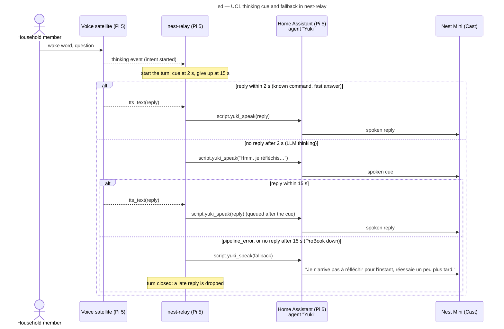

# Sequence diagram — voice-assistant — UC1 Ask a question by voice — thinking cue and fallback

> **Feature**: voice-assistant (benoit-bremaud/confiture#25)
> **Source specs**: [`voice-assistant-needs.md`](../../specs/voice-assistant-needs.md) (REQ-3, REQ-9, NFR-5)
> **Related ADRs**: ADR-0003, ADR-0004, ADR-0005
> **See also**: [`02-sequence-ask-a-question.md`](02-sequence-ask-a-question.md),
> [`04-sequence-ask-by-voice.md`](04-sequence-ask-by-voice.md)

## Context

Refines the `nest-relay` part of `04-sequence-ask-by-voice.md` for the LLM path. A known command
answers in under a second, but the LLM on the ProBook takes about 4 to 10 s, and nothing tells
the member that Yuki heard. When the ProBook is off, Home Assistant ends the run with a technical
error and the Nest stays silent. `nest-relay` watches the satellite's events and, in French:

- speaks a short thinking cue when no reply arrives within 2 s of the `thinking` event (NFR-5);
- speaks a friendly fallback when the run fails or no reply arrives within 15 s (ADR-0004).

`script.yuki_speak` runs in `queued` mode, so a reply that follows the cue plays after it.

## Diagram

## Notes

- A `pipeline_error` before `thinking` (wake word taken by another satellite, nothing
  understood) is not a turn: the relay stays silent, as before.
- A `pipeline_error` within 2 s speaks the fallback without the cue.
- Event names are the satellite's peripheral events (Linux Voice Assistant 1.1.18,
  `peripheral_api.LVAEvent`): `thinking` is sent at every intent start, known commands
  included; `idle` at the end of the run closes the turn, so a reply after a fallback is
  dropped only within the same run.
- `nest-relay` speaks one text at a time and waits for each Home Assistant call (10 s timeout):
  the cue finishes before the reply is sent. If Home Assistant itself is down, nothing can be
  spoken and the relay only logs a warning.
- The timers live in `nest-relay`, not in Home Assistant: no Home Assistant change, and the
  logic is a pure state machine with unit tests (the clock is injected).
- The cue and the fallback are fixed French sentences, gentle and child-friendly (REQ-9); the LLM
  still has no control of the house (ADR-0005, `llm_hass_api: []`).
